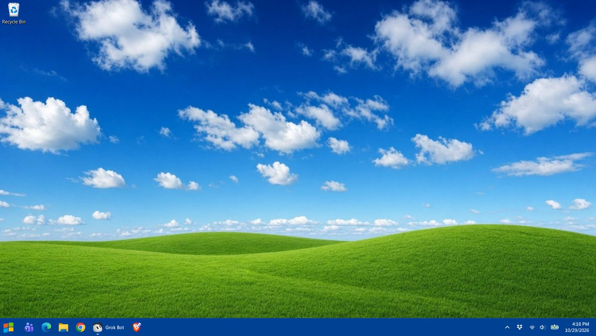

# winxp-decrapify

Decrapify Windows 10/11 (remove Copilot, ads, telemetry and preinstalled bloat)
and give it a Windows XP look. Plain PowerShell you can read before you run,
with a dry-run mode (`-WhatIf`) and an undo script.

**Version 1.0.1** (2026-11-01)



*After: Bliss-style wallpaper, XP-blue taskbar, left-aligned, XP-style start
button with the Open-Shell classic menu. (Screenshot from the author's own
laptop, so his pinned taskbar apps show.)*

> **Use at your own risk.** This removes apps and changes system settings.
> Read the app lists in `Decrapify.ps1`, run everything with `-WhatIf` first,
> and keep a restore point (the `-Machine` tier makes one for you).

## Contents

- [Why](#why)
- [What's in the kit](#whats-in-the-kit)
- [Requirements](#requirements)
- [Quick start](#quick-start)
- [Switch reference](#switch-reference)
- [Exactly what Decrapify.ps1 changes](#exactly-what-decrapifyps1-changes)
- [The XP theme (Install-XPTheme.ps1)](#the-xp-theme-install-xpthemeps1)
- [Undo and the state file](#undo-and-the-state-file)
- [Logs](#logs)
- [FAQ and troubleshooting](#faq-and-troubleshooting)
- [Safety notes](#safety-notes)
- [Tested on](#tested-on)
- [Trademarks](#trademarks)
- [Contributing](#contributing)
- [License](#license)
- [Changelog](#changelog)

## Why

Plenty of people keep an old Windows laptop around for the few things Linux
can't do well (DRM streaming, some games, vendor tools). Out of the box,
Windows 11 ships Copilot, ads in Start and on the lock screen, Bing in the
search box, widgets, telemetry and a pile of OEM helper apps. This kit makes
that machine lean and quiet, then makes it look like the XP desktop a lot of
us grew up with. Every change is logged and almost every change is reversible.

## What's in the kit

| File | Does |
|---|---|
| `Decrapify.ps1` | Removes bloat apps, turns off ads, Copilot, Bing in search, widgets, telemetry. |
| `Install-XPTheme.ps1` | Installs Open-Shell (hash-checked) and applies the XP look. |
| `Undo.ps1` | Reverts what the two scripts changed, from their saved state file. |
| `lib/Common.ps1` | Shared helpers (logging, state file, WhatIf-safe changes). |
| `assets/` | Start button, wallpaper, flag icon. All made for this kit ([details](assets/README.md)). |
| `docs/after.jpg` | The screenshot above. |

## Requirements

- Windows 11 (tested; see [Tested on](#tested-on)). Windows 10 should mostly
  work (missing apps and settings are skipped) but is **untested**.
- Windows PowerShell 5.1 (built in) or PowerShell 7.
- Admin rights for `-Machine` and for installing Open-Shell. Everything else
  runs as a normal user.
- Internet access for the Open-Shell download (from its official GitHub release).

## Quick start

1. Get the files: **Code → Download ZIP** and extract it, or
   `git clone https://github.com/noblebrown-69/winxp-decrapify.git`.
2. Open PowerShell **as administrator** (Start → type `powershell` → right-click
   → *Run as administrator*), using **your own** account. Theme settings are
   per user; elevating as a different admin account themes that account.
3. `cd` to the extracted folder and run:

```powershell
# Allow scripts for this window only, and unblock the downloaded files
Set-ExecutionPolicy -Scope Process Bypass -Force
Get-ChildItem -Recurse | Unblock-File

# 1. Dry run: prints every change, changes nothing
.\Decrapify.ps1 -Machine -RemoveOemBloat -WhatIf
.\Install-XPTheme.ps1 -WhatIf

# 2. For real
.\Decrapify.ps1 -Machine -RemoveOemBloat
.\Install-XPTheme.ps1
```

4. Sign out and back in (or reboot) so every change shows.

No admin? `.\Decrapify.ps1` alone does the current-user part, and
`.\Install-XPTheme.ps1 -SkipOpenShell` does the colors, wallpaper and taskbar
without the XP Start button.

Want only one half? Each script stands alone: run just `Decrapify.ps1` for a
clean Windows with the normal look, or just `Install-XPTheme.ps1` for the look.

## Switch reference

All three scripts accept the standard `-WhatIf` (show, don't change) and
`-Verbose`.

### Decrapify.ps1

| Switch | Admin? | What it does |
|---|---|---|
| *(none)* | No | Current-user tier: removes the default app list for you, applies the HKCU privacy/ads/taskbar tweaks. |
| `-Machine` | Yes | Adds the machine tier: restore point, all-users removal + deprovisioning, policies, services, tasks, Copilot desktop app uninstall. |
| `-RemoveMailAndOneNote` | No | Also removes new Outlook, Mail & Calendar and OneNote (Store). **Off by default.** |
| `-RemoveOemBloat` | No (services/MSI need `-Machine`) | HP, Dell, Lenovo, Asus, Acer helper apps; with `-Machine`, HP analytics services and HP Connection Optimizer. |
| `-RemoveXbox` | No (services need `-Machine`) | Xbox apps; with `-Machine`, Xbox services. Breaks Game Pass and Xbox sign-in in games. |
| `-DisableSysMain` | Yes, with `-Machine` | Disables SysMain (Superfetch). Fine on an SSD, can slow an old spinning drive. |
| `-RemoveStartupItems` | No | Removes your startup (HKCU Run) entries whose name matches `-StartupPattern`. |
| `-StartupPattern '<regex>'` | No | Regex for the above, e.g. `'Spotify|Discord'`. Empty by default, which removes nothing and just lists your entries. |
| `-Keep '<pkg>','<pkg>'` | No | Package names to skip even if they are on a removal list. |

Example: keep Sticky Notes and Clock, but also drop Mail/OneNote:

```powershell
.\Decrapify.ps1 -Machine -RemoveMailAndOneNote -Keep 'Microsoft.MicrosoftStickyNotes','Microsoft.WindowsAlarms'
```

### Install-XPTheme.ps1

| Switch | What it does |
|---|---|
| *(none)* | Installs Open-Shell if missing (needs admin), then applies the whole look. |
| `-SkipOpenShell` | Skip Open-Shell install and its settings. Colors, wallpaper and taskbar only; no admin needed. |
| `-CenterTaskbar` | Keep the Windows 11 centered taskbar instead of left-aligning it. |

### Undo.ps1

| Switch | What it does |
|---|---|
| *(none)* | Reverts everything recorded in the state file. Run elevated to also revert HKLM policies, services and tasks. |
| `-KeepOpenShell` | Don't uninstall Open-Shell even if the kit installed it. |

## Exactly what Decrapify.ps1 changes

### Apps removed by default

Copilot (`Microsoft.Copilot`, `Microsoft.Windows.Ai.Copilot.Provider`),
Bing News, Bing Search, Bing Weather, Get Help, Messaging, 3D Viewer, Office
hub (`MicrosoftOfficeHub`), Solitaire Collection, Mixed Reality Portal,
OneConnect, People, Print 3D, Skype, To Do, Feedback Hub, Maps, Sound
Recorder, Phone Link (`YourPhone`), Cross Device, Power Automate Desktop,
Movies & TV (`ZuneVideo`), Family, Quick Assist, Dev Home, Sticky Notes,
Clock (`WindowsAlarms`), Widgets (`Client.WebExperience`,
`WidgetsPlatformRuntime`), Clipchamp, Netflix. Several are retired on current
builds; names that aren't installed are skipped. The exact package names are
in the `$CoreApps` list at the top of `Decrapify.ps1`.

**Kept by default** (removed only with `-RemoveMailAndOneNote`): new Outlook
(`Microsoft.OutlookForWindows`), Mail & Calendar
(`microsoft.windowscommunicationsapps`), OneNote (`Microsoft.Office.OneNote`).

Not touched at all: Microsoft Store, Edge, Photos, Calculator, Notepad,
Terminal, Snipping Tool, Paint, Camera, Settings, OneDrive, Teams (only its
auto-start is turned off).

### Current-user registry (no admin)

`HKCU\Software\Microsoft\Windows\CurrentVersion\Explorer\Advanced`:

| Value | Set to | Effect |
|---|---|---|
| `TaskbarDa` | 0 | Hide Widgets button (newer builds block this; the machine policy covers it) |
| `TaskbarMn` | 0 | Hide Chat/Teams button |
| `ShowTaskViewButton` | 0 | Hide Task View |
| `ShowCopilotButton` | 0 | Hide Copilot button |
| `ShowSyncProviderNotifications` | 0 | No OneDrive/M365 ads in Explorer |
| `Start_IrisRecommendations` | 0 | No "Recommended" tips in Start |
| `Start_AccountNotifications` | 0 | No account nags in Start |
| `Start_TrackProgs` | 0 | Don't track app launches |
| `HideFileExt` | 0 | Show file extensions |

Other HKCU values:

| Key | Value = data | Effect |
|---|---|---|
| `...\CurrentVersion\Search` | `SearchboxTaskbarMode`=0, `BingSearchEnabled`=0 | Hide search box, no Bing in Start search |
| `...\CurrentVersion\SearchSettings` | `IsDynamicSearchBoxEnabled`=0 | No "search highlights" |
| `Software\Policies\Microsoft\Windows\Explorer` | `DisableSearchBoxSuggestions`=1 | No web suggestions |
| `Software\Policies\Microsoft\Windows\WindowsCopilot` | `TurnOffWindowsCopilot`=1 | Copilot off (user policy) |
| `...\CurrentVersion\AdvertisingInfo` | `Enabled`=0 | Advertising ID off |
| `...\CurrentVersion\Privacy` | `TailoredExperiencesWithDiagnosticDataEnabled`=0 | No tailored experiences |
| `...\CurrentVersion\BackgroundAccessApplications` | `GlobalUserDisabled`=1 | Store apps can't run in background (can delay notifications from Store apps like WhatsApp) |
| `System\GameConfigStore` | `GameDVR_Enabled`=0 | Game DVR off |
| `...\CurrentVersion\GameDVR` | `AppCaptureEnabled`=0 | App capture off |
| `...\CurrentVersion\UserProfileEngagement` | `ScoobeSystemSettingEnabled`=0 | No "finish setting up your PC" nag |
| `...\CurrentVersion\ContentDeliveryManager` | 18 values set to 0 (`ContentDeliveryAllowed`, `SubscribedContentEnabled`, `SystemPaneSuggestionsEnabled`, `SoftLandingEnabled`, `RotatingLockScreenOverlayEnabled`, `SilentInstalledAppsEnabled`, `PreInstalledAppsEnabled`, `OemPreInstalledAppsEnabled`, `PreInstalledAppsEverEnabled`, `SubscribedContent-310093/314563/338387/338388/338389/338393/353694/353696/353698Enabled`) | Suggested apps, silent app installs, lock screen and Start ads, tips |
| Teams `TeamsStartupTask` (only if Teams is installed) | `State`=1 | New Teams doesn't auto-start |

### Machine tier (`-Machine`, admin)

1. **Restore point** "Before winxp-decrapify" before anything else (Windows
   allows one per 24 hours; if that blocks it, the script warns and continues).
2. **Apps** above removed for all users and deprovisioned so new accounts don't get them.
3. **Policies** (`HKLM\SOFTWARE\Policies\Microsoft\...`):

| Key | Value = data | Effect |
|---|---|---|
| `Windows\WindowsCopilot` | `TurnOffWindowsCopilot`=1 | Copilot off |
| `Windows\WindowsAI` | `DisableAIDataAnalysis`=1 | Recall snapshots off |
| `Windows\CloudContent` | `DisableWindowsConsumerFeatures`=1, `DisableSoftLanding`=1 | No auto-installed promo apps or tips |
| `Windows\Windows Feeds` | `EnableFeeds`=0 | News and interests off |
| `Dsh` | `AllowNewsAndInterests`=0 | Widgets off |
| `Windows\DataCollection` | `AllowTelemetry`=0 | Minimum telemetry (fully honored only on Enterprise/Education) |
| `Windows\AdvertisingInfo` | `DisabledByGroupPolicy`=1 | Advertising ID off |
| `Edge` | `StartupBoostEnabled`=0, `BackgroundModeEnabled`=0, `HubsSidebarEnabled`=0, `CopilotCDPPageContext`=0, `HideFirstRunExperience`=1 | No Edge preloading, background running, sidebar/Copilot pane, Copilot page reading, first-run wizard |

4. **Services disabled:** `DiagTrack` (telemetry), `dmwappushservice`,
   `MapsBroker`, `RetailDemo`, `PhoneSvc`, `WMPNetworkSvc`, `Fax`. Plus Xbox
   (`XblAuthManager`, `XblGameSave`, `XboxGipSvc`, `XboxNetApiSvc`) with
   `-RemoveXbox`, HP (`HPAppHelperCap`, `HPDiagsCap`, `HPNetworkCap`,
   `HPSysInfoCap`, `HpTouchpointAnalyticsService`) with `-RemoveOemBloat`,
   and `SysMain` with `-DisableSysMain`.
5. **Scheduled tasks disabled** (under `\Microsoft\Windows\`):
   `Application Experience\Microsoft Compatibility Appraiser`,
   `ProgramDataUpdater`, `StartupAppTask`,
   `Customer Experience Improvement Program\Consolidator`, `UsbCeip`,
   `Feedback\Siuf\DmClient`, `DmClientOnScenarioDownload`.
6. **Copilot desktop app** uninstalled by finding `copilot_setup.exe` under
   Program Files and running its own system-level uninstall.
7. With `-RemoveOemBloat`: **HP Connection Optimizer** (MSI) uninstalled quietly.

### OEM apps (`-RemoveOemBloat`)

HP (JumpStarts, Printer Control, Privacy Settings, Energy Star, PC Hardware
Diagnostics, myHP, Support Assistant, QuickDrop, System Information, Power
Manager), Dell (Digital Delivery, SupportAssist, PartnerPromo), Lenovo
(Companion/Vantage, Settings for Enterprise, Utility), Asus (PC Assistant,
MyASUS), Acer (Care Center, Quick Access). See `$OemApps` for package names.

### Xbox apps (`-RemoveXbox`)

Xbox app, Xbox TCUI, Game Overlay, Game Bar, Identity Provider, Speech-to-Text
Overlay, Gaming App, Edge Game Assist.

## The XP theme (Install-XPTheme.ps1)

1. **Open-Shell** [4.4.198](https://github.com/Open-Shell/Open-Shell-Menu/releases/tag/v4.4.198)
   is downloaded from its official GitHub release and its SHA256 is checked
   against a pinned hash
   (`a4d2d4459de55b5e962ba2a14f7bb794170511649138173dfa72949837b48c3f`).
   On mismatch the script aborts. It installs silently with only Start Menu
   and Classic Explorer. Skipped if Open-Shell is already installed or with
   `-SkipOpenShell`. The installer is not redistributed in this repo.
2. **Assets** are copied to `%LOCALAPPDATA%\winxp-decrapify\assets`
   (Open-Shell reads the start button from there, so you can delete the
   download folder afterwards).
3. **Open-Shell settings** (`HKCU\Software\OpenShell\StartMenu\Settings`):
   classic two-column menu (`Classic2`) with the *Windows XP Luna* skin,
   custom XP-style start button, skip the Metro screen, first-run prompts
   suppressed.
4. **Wallpaper:** `xp_style_wallpaper.jpg`, Fill. Your previous wallpaper is
   saved for Undo.
5. **Colors:** accent XP blue `#245EDC` on taskbar and Start, transparency
   off, dark system (taskbar) with light apps.
6. **Taskbar:** hides search, Task View, Widgets and Chat, and left-aligns it
   (`-CenterTaskbar` keeps it centered). Explorer restarts at the end.

**Swap the wallpaper:** replace `assets\xp_style_wallpaper.jpg` with any JPG
of the same name before running the script (the bundled one is 1280x720), or
after install just set your own in Settings → Personalization → Background.

**Change the start button:** replace `assets\xp_start_button.png` with a
same-layout sprite (3 stacked states: normal, hover, pressed), or point
Open-Shell at another image in *Open-Shell Menu Settings → Start Button*.

## Undo and the state file

```powershell
.\Undo.ps1 -WhatIf
.\Undo.ps1            # as administrator to also revert policies, services, tasks
```

Both apply scripts save the previous value of everything they touch in
`%LOCALAPPDATA%\winxp-decrapify\state.json` before changing it. Undo:

- puts previous registry values back and deletes values the kit created,
- re-enables only the services and tasks the kit disabled (to their old start type),
- restores your old wallpaper and any startup entries the kit removed,
- uninstalls Open-Shell if the kit installed it (`-KeepOpenShell` to keep it).

Run non-elevated, Undo reverts the user parts and keeps the HKLM items in the
state file for a later elevated run.

**Removed apps can't be put back by script.** Undo prints the list; reinstall
any you want from the Microsoft Store or with
`winget install --id <Id> --source msstore`. Your restore point is the other
way back (*Control Panel → Recovery → Open System Restore*).

Don't delete `state.json` if you might want to undo later. Re-running the
apply scripts is safe: values already recorded keep their original "before".

## Logs

Every run writes a timestamped log to `%USERPROFILE%\decrapify-logs\`
(e.g. `Decrapify-20261101-120000.log`), and the path is printed at the end.
Lines are tagged `OK`, `SKIP`, `WARN` or `FAIL`.

## FAQ and troubleshooting

**"running scripts is disabled on this system"**: run
`Set-ExecutionPolicy -Scope Process Bypass -Force` in that window first. It
only lasts for that window and doesn't change your system policy.

**"not digitally signed" / security warning for each file**: the ZIP was
marked as downloaded. Run `Get-ChildItem -Recurse | Unblock-File` in the folder.

**SmartScreen or antivirus complains**: the scripts are unsigned plain text;
read them first if you're unsure. Some antivirus tools flag any debloat script
generically. The only binary downloaded is Open-Shell from its official release,
verified by hash.

**"-Machine needs an elevated PowerShell"**: open PowerShell with *Run as
administrator*.

**Windows Update brought apps or settings back**: monthly updates sometimes
reprovision apps or reset settings. Re-run the same command; it's idempotent.

**Copilot came back after a feature update**: big yearly updates (e.g. 24H2
→ 25H2) can reinstall the Copilot app. Re-run `.\Decrapify.ps1 -Machine`; the
policies usually survive and keep it off even before you do.

**The Widgets button is still there**: newer builds block scripts from writing
`TaskbarDa`. The `-Machine` Widgets policy removes it; or toggle it in
Settings → Personalization → Taskbar.

**Start button looks wrong or the Windows 11 menu still opens**: sign out and
back in. Make sure you ran `Install-XPTheme.ps1` elevated as *your own* user.
Open *Open-Shell Menu Settings* from the Start menu to tweak anything; your
changes there won't break Undo.

**Open-Shell download fails or hash mismatch**: the script aborts without
installing. Check your connection or proxy, or install Open-Shell 4.4.198
yourself and re-run; an existing install is detected and configured.

**Store app notifications are late**: Settings → Apps → Installed apps →
the app → Advanced options → Background app permissions, or run Undo.

**I need Quick Assist / Sticky Notes / Clock**: add them to `-Keep`, or
reinstall them from the Store.

## Safety notes

- Run `-WhatIf` first and read the output.
- The `-Machine` tier makes a restore point, but Windows may skip it if one
  was made in the last 24 hours. Make one by hand if you want to be sure.
- This doesn't touch Windows Update, Defender, the firewall, drivers or Edge
  itself, and it doesn't delete user files.
- Telemetry can't be fully disabled on Home/Pro; this sets the minimum level
  Windows allows.
- Provided as-is, with no warranty (see [LICENSE](LICENSE)). You are
  responsible for what you run on your machine.

## Tested on

- **One machine:** an HP consumer laptop, Windows 11 Home 25H2 (build 26200).
- v1.0.x is a cleaned-up, generalized version of what was originally run on
  that laptop. The release scripts were syntax-checked (PowerShell 7.4 and
  Windows PowerShell 5.1, zero errors) and dry-run with `-WhatIf` there.
- **Not tested:** a real (non-dry-run) pass of the release scripts on a clean
  install; the `-Machine` tier beyond the parser check; Windows 10; Pro,
  Enterprise or Education; ARM devices; Dell, Lenovo, Asus or Acer machines;
  non-English Windows.

Reports from other setups are very welcome (open an issue).

## Trademarks

Windows, Windows XP, Bliss and Luna are trademarks or artwork of Microsoft.
This project is not affiliated with or endorsed by Microsoft. The XP-style
start button, wallpaper and flag icon are lookalikes made for this kit; no
Microsoft files are included. Open-Shell is separate MIT-licensed software,
downloaded from its own release page.

## Contributing

Issues and pull requests are welcome, especially:

- test reports from other Windows editions and PC makers (include your
  `winver` and the log file),
- app package names for other OEMs,
- a sharper original wallpaper.

Please keep changes WhatIf-safe (go through the helpers in `lib/Common.ps1`
so they're logged and recorded for Undo), and keep anything risky behind an
opt-in switch.

## License

[MIT](LICENSE) © Noble Brown

## Changelog

- **1.0.1** (2026-11-01): new Outlook, Mail & Calendar and OneNote are no
  longer removed by default; new `-RemoveMailAndOneNote` switch removes them.
  README expanded with a full switch reference and change list.
- **1.0.0** (2026-10-31): first release.
